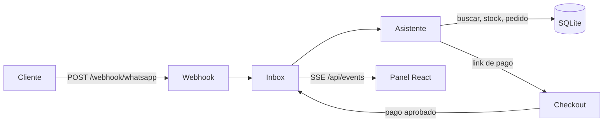

# Chat Commerce AI

Bandeja de chats para negocios que venden por WhatsApp. Un asistente responde con el catálogo, los precios y el stock reales, arma el carrito, confirma el pedido reservando stock y manda el link de pago. Cuando el pago se aprueba, el cliente recibe la confirmación en el mismo chat. Un vendedor puede leer todo en vivo, tomar el control de la conversación y apagar el asistente.


## Probalo

```bash
npm install
npm run dev        # http://localhost:3000
```

Entrá a **Simulador de cliente** y escribí como si fueras el cliente: "¿tenés termos?", "quiero 2 bombillas", "confirmar". Abrí el link de pago, pagá y mirá cómo se actualizan **Mensajes**, **Pedidos** y **Productos** en tiempo real.


## Cómo funciona



- **Webhook con el formato de WhatsApp Cloud API.** El simulador manda exactamente el payload que manda Meta, así que conectar un número real no cambia el backend. Los mensajes repetidos se descartan por `wa_id`, porque WhatsApp reintenta los webhooks.
- **Asistente sobre funciones de negocio.** El asistente no inventa datos: busca productos, valida stock y crea pedidos con funciones de `server/commerce.js`. Hoy decide con reglas (`server/agent.js`), y la misma interfaz `(db, conversación, texto) → { reply, cart, needsHuman }` es la que va a usar un modelo de lenguaje con *function calling*.
- **Stock consistente.** Confirmar un pedido descuenta el stock en una transacción con `UPDATE … WHERE stock >= ?`. Si dos clientes compran la última unidad a la vez, uno solo la consigue y al otro se le avisa.
- **Derivación a una persona.** Si el cliente lo pide o el asistente no entiende, la conversación queda marcada como "Espera respuesta". Si el vendedor apaga el asistente, todo lo nuevo le llega a él.
- **Tiempo real con Server-Sent Events.** No usa WebSockets ni polling.
- **Pagos idempotentes.** Una notificación de pago repetida no confirma dos veces.

## Stack

| Capa | Tecnología |
|---|---|
| Frontend | React 19 + Vite |
| Backend | Node.js + Express 5 |
| Base de datos | SQLite (`node:sqlite`, sin dependencias nativas) |
| Tests | `node:test` |

Requiere Node.js 22.13 o posterior.

## Estructura

```
server/
  app.js        rutas HTTP, webhook, SSE y checkout
  inbox.js      conversaciones, mensajes, derivación y pagos
  agent.js      asistente de ventas
  commerce.js   catálogo, pedidos y stock
  db.js         esquema y datos de ejemplo
web/src/
  views/        Mensajes, Pedidos, Productos y Simulador
test/
  flow.test.js  flujo completo de venta
```

## Scripts

| Comando | Qué hace |
|---|---|
| `npm run dev` | Servidor con recarga y Vite integrado en el mismo puerto |
| `npm test` | Tests del flujo de venta, stock, duplicados y derivación |
| `npm run build` | Compila el frontend en `web/dist` |
| `npm start` | Producción: sirve la API y el frontend compilado |

Variables opcionales: `PORT` (3000), `PUBLIC_URL` (la base de los links de pago) y `DB_FILE` (`data.db`).

## Próximos pasos

- Asistente con LLM y *function calling* sobre las funciones de `commerce.js`.
- Envío real por WhatsApp Cloud API y verificación del webhook.
- Mercado Pago Checkout Pro en lugar del checkout simulado.
- Vencimiento de pedidos impagos para liberar el stock reservado.
- Instagram y Messenger en la misma bandeja.

## Licencia

MIT
