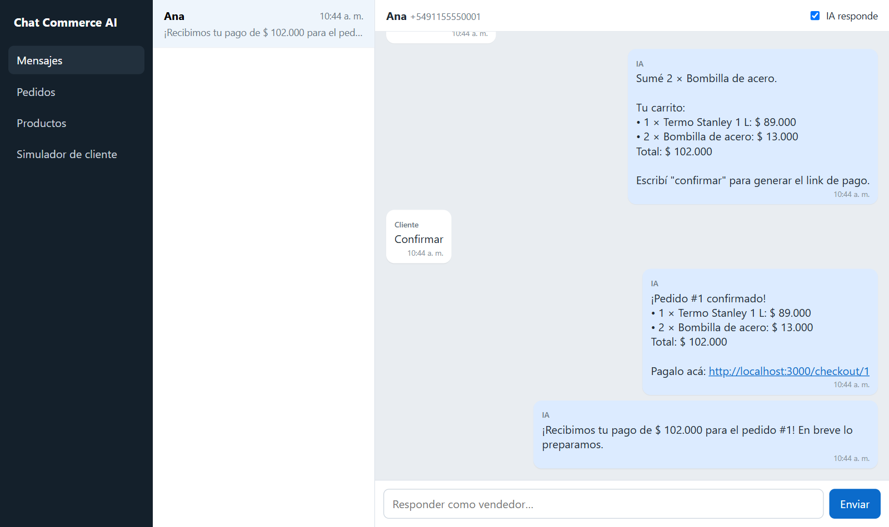
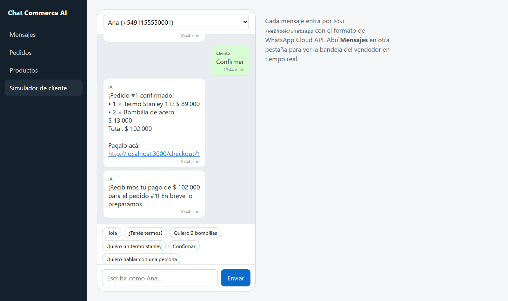
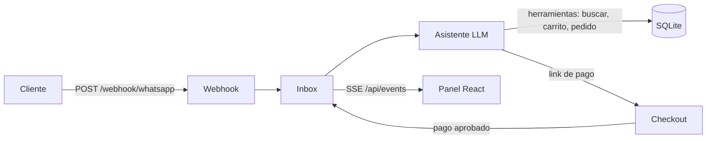

# Chat Commerce AI

Bandeja de chats para negocios que venden por WhatsApp. Un asistente con IA (Gemini, con *function calling*) responde con el catálogo, los precios y el stock reales, arma el carrito, confirma el pedido reservando stock y manda el link de pago. Cuando el pago se aprueba, el cliente recibe la confirmación en el mismo chat. Un vendedor puede leer todo en vivo, tomar el control de la conversación y apagar el asistente.



## Probalo

```bash
npm install
echo GEMINI_API_KEY=tu-clave > .env   # opcional: clave gratis en https://aistudio.google.com
npm run dev                           # http://localhost:3000
```

Sin clave funciona igual, con el asistente de reglas.

Entrá a **Simulador de cliente** y escribí como si fueras el cliente: "¿tenés termos?", "quiero 2 bombillas", "confirmar". Abrí el link de pago, pagá y mirá cómo se actualizan **Mensajes**, **Pedidos** y **Productos** en tiempo real.



## Cómo funciona



- **Webhook con el formato de WhatsApp Cloud API.** El simulador manda exactamente el payload que manda Meta, así que conectar un número real no cambia el backend. Los mensajes repetidos se descartan por `wa_id`, porque WhatsApp reintenta los webhooks.
- **La IA conversa; el backend decide.** El modelo opera solo con herramientas (`buscar_productos`, `agregar_al_carrito`, `confirmar_pedido`, `derivar_a_humano`…) definidas en `server/llm-agent.js`. Precios, stock y links de pago salen de la base, así que el modelo no puede inventar un precio ni vender sin stock: si pide 10 unidades y hay 6, la herramienta se lo rechaza.
- **Proveedor intercambiable.** Habla con cualquier API compatible con OpenAI Chat Completions. Por defecto usa Gemini por su plan gratuito; para OpenAI o Groq alcanza con cambiar `LLM_BASE_URL`, `LLM_API_KEY` y `LLM_MODELS`.
- **Siempre responde.** Si un modelo está saturado o sin cupo pasa al siguiente de `LLM_MODELS`. Si ninguno contesta, o se agotó el cupo diario (`LLM_DAILY_LIMIT`), responde el asistente de reglas (`server/agent.js`). Si la IA falla después de crear el pedido, el cliente igual recibe su link de pago.
- **Mensajes en orden.** Los mensajes de un mismo cliente se procesan de a uno, así dos mensajes seguidos no se pisan el carrito.
- **Stock consistente.** Confirmar un pedido descuenta el stock en una transacción con `UPDATE … WHERE stock >= ?`. Si dos clientes compran la última unidad a la vez, uno solo la consigue y al otro se le avisa.
- **Derivación a una persona.** Si el cliente lo pide o el asistente no entiende, la conversación queda marcada como "Espera respuesta". Si el vendedor apaga el asistente, todo lo nuevo le llega a él.
- **Tiempo real con Server-Sent Events.** No usa WebSockets ni polling.
- **Pagos idempotentes.** Una notificación de pago repetida no confirma dos veces.

## Stack

| Capa | Tecnología |
|---|---|
| Frontend | React 19 + Vite |
| Backend | Node.js + Express 5 |
| Base de datos | SQLite (`node:sqlite`, sin dependencias nativas) |
| Tests | `node:test` |

Requiere Node.js 22.13 o posterior.

## Estructura

```
server/
  app.js        rutas HTTP, webhook, SSE y checkout
  inbox.js      conversaciones, mensajes, derivación y pagos
  llm-agent.js  asistente con IA: herramientas, cliente del modelo y respaldo
  agent.js      asistente de reglas (sin API key)
  commerce.js   catálogo, pedidos y stock
  db.js         esquema y datos de ejemplo
web/src/
  views/        Mensajes, Pedidos, Productos y Simulador
test/
  flow.test.js  flujo completo de venta
```

## Scripts

| Comando | Qué hace |
|---|---|
| `npm run dev` | Servidor con recarga y Vite integrado en el mismo puerto |
| `npm test` | Tests del flujo de venta, stock, duplicados, derivación y del agente con IA (con un modelo simulado) |
| `npm run build` | Compila el frontend en `web/dist` |
| `npm start` | Producción: sirve la API y el frontend compilado |

Variables opcionales (se pueden poner en `.env`):

| Variable | Por defecto | Para qué |
|---|---|---|
| `GEMINI_API_KEY` o `LLM_API_KEY` | (sin IA) | Clave del proveedor del modelo |
| `LLM_BASE_URL` | API de Gemini compatible con OpenAI | Cambiar de proveedor |
| `LLM_MODELS` | `gemini-3.5-flash,gemini-3.1-flash-lite,gemini-3-flash-preview` | Modelos a probar, en orden |
| `LLM_DAILY_LIMIT` | `300` | Respuestas con IA por día; protege el cupo en una demo pública |
| `PORT` | `3000` | Puerto |
| `PUBLIC_URL` | `http://localhost:3000` | Base de los links de pago |
| `DB_FILE` | `data.db` | Archivo de SQLite |

## Próximos pasos

- Respuestas en streaming e indicador de "escribiendo…".
- Envío real por WhatsApp Cloud API y verificación del webhook.
- Mercado Pago Checkout Pro en lugar del checkout simulado.
- Vencimiento de pedidos impagos para liberar el stock reservado.
- Instagram y Messenger en la misma bandeja.

## Licencia

MIT
