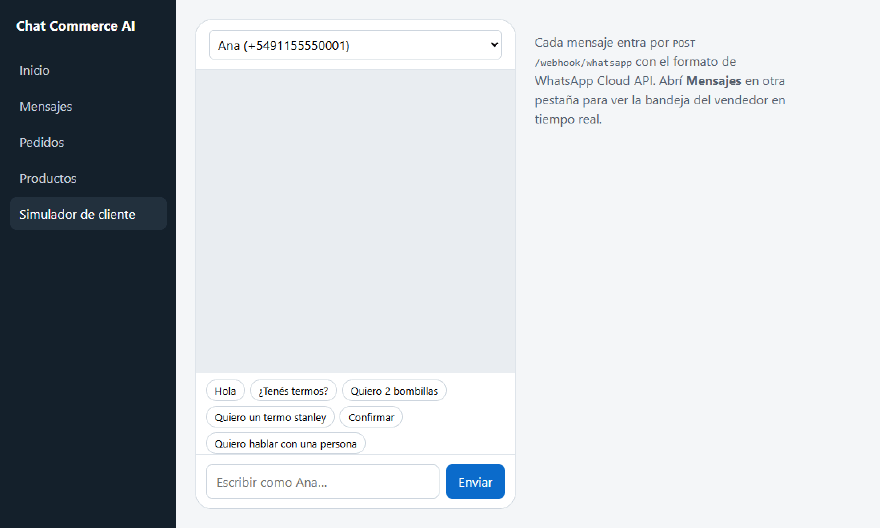
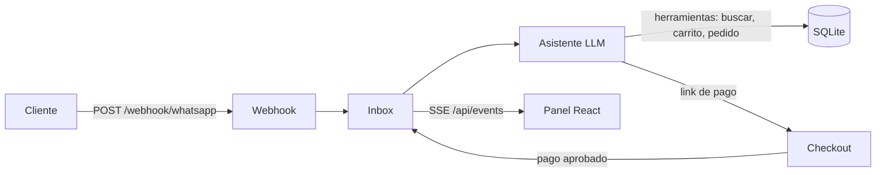

# Chat Commerce AI

[](https://github.com/octavioaguerodev-cpu/chat-commerce-ai/actions/workflows/ci.yml)

Bandeja de chats para negocios que venden por WhatsApp. Un asistente con IA (Gemini, con *function calling*) responde con el catálogo, los precios y el stock reales, arma el carrito, confirma el pedido reservando stock y manda el link de pago. Cuando el pago se aprueba, el cliente recibe la confirmación en el mismo chat. Un vendedor puede leer todo en vivo, tomar el control de la conversación y apagar el asistente.

**Demo:** https://chat-commerce-ai.onrender.com (entrá a *Simulador de cliente* y escribí como si fueras un cliente). Corre en el plan gratuito de Render: si estuvo un rato sin visitas, la primera carga tarda alrededor de un minuto, y los pedidos de prueba se borran cuando el servicio se reinicia.



## Probalo

```bash
npm install
echo GEMINI_API_KEY=tu-clave > .env   # opcional: clave gratis en https://aistudio.google.com
npm run dev                           # http://localhost:3000
```

Sin clave funciona igual, con el asistente de reglas.

Entrá a **Simulador de cliente** y escribí como si fueras el cliente: "busco un regalo para alguien que toma mate", "sumame el termo y una bombilla", "confirmo", y cuando te pida los datos, tu nombre y "retiro en el local" o "envío a" una dirección. Cada visitante es un cliente nuevo con su propio número. Abrí el link de pago, pagá y mirá cómo se actualizan **Inicio**, **Mensajes** y **Pedidos** en tiempo real. El panel también se usa desde el celular.

## Cómo funciona



- **Webhook con el formato de WhatsApp Cloud API.** El simulador manda exactamente el payload que manda Meta, así que conectar un número real no cambia el backend. Los mensajes repetidos se descartan por `wa_id`, porque WhatsApp reintenta los webhooks.
- **La IA conversa; el backend decide.** El modelo opera solo con herramientas (`buscar_productos`, `agregar_al_carrito`, `guardar_datos_cliente`, `confirmar_pedido`, `derivar_a_humano`…) definidas en `server/llm-agent.js`. Precios, stock y links de pago salen de la base, así que el modelo no puede inventar un precio ni vender sin stock: si pide 10 unidades y hay 6, la herramienta se lo rechaza.
- **Proveedor intercambiable.** Habla con cualquier API compatible con OpenAI Chat Completions. Por defecto usa Gemini por su plan gratuito; para OpenAI o Groq alcanza con cambiar `LLM_BASE_URL`, `LLM_API_KEY` y `LLM_MODELS`.
- **Siempre responde.** Si un modelo está saturado o sin cupo pasa al siguiente de `LLM_MODELS`. Si ninguno contesta, o se agotó el cupo diario (`LLM_DAILY_LIMIT`), responde el asistente de reglas (`server/agent.js`). Si la IA falla después de crear el pedido, el cliente igual recibe su link de pago.
- **Mensajes en orden.** Los mensajes de un mismo cliente se procesan de a uno, así dos mensajes seguidos no se pisan el carrito.
- **Datos de entrega antes de confirmar.** Sin nombre de quien recibe y forma de entrega (retiro en el local o envío con dirección) el backend no crea el pedido: la IA se los pide al cliente y los guarda con `guardar_datos_cliente`, que valida que el envío tenga dirección. Quedan guardados para el próximo pedido. El nombre de perfil de WhatsApp solo se usa para saludar.
- **Stock consistente.** Confirmar un pedido descuenta el stock en una transacción con `UPDATE … WHERE stock >= ?`. Si dos clientes compran la última unidad a la vez, uno solo la consigue y al otro se le avisa.
- **Pedidos que vencen.** Un pedido sin pagar vence a los `ORDER_TTL_MINUTES` (30 por defecto): devuelve el stock reservado, avisa al cliente por el chat y el link de pago deja de funcionar.
- **Derivación a una persona.** Si el cliente lo pide o el asistente no entiende, la conversación queda marcada como "Espera respuesta". Si el vendedor apaga el asistente, todo lo nuevo le llega a él.
- **Tiempo real con Server-Sent Events.** No usa WebSockets ni polling. Mientras la IA piensa, el cliente y el vendedor ven "escribiendo…".
- **Inicio con las métricas del día.** Ventas cobradas, pendientes de cobro, chats, qué porcentaje respondió la IA, quién espera respuesta, lo más vendido y el stock bajo, calculado en SQL.
- **Pagos idempotentes.** Una notificación de pago repetida no confirma dos veces.
- **Se ve qué hizo la IA.** En **Mensajes**, cada respuesta muestra las herramientas que usó ("buscó 'termo'", "sumó 2 × YER-1KG", "confirmó el pedido") y cuáles le rechazó el backend, por ejemplo por falta de stock. También avisa cuando respondió el asistente de reglas.
- **Webhook protegido.** Con `WHATSAPP_APP_SECRET` solo acepta mensajes firmados por Meta (`X-Hub-Signature-256`, comparado en tiempo constante), y responde la verificación `GET` de Meta con `WHATSAPP_VERIFY_TOKEN`. Sin secreto (la demo con simulador) se limita por IP. Además, la IA tiene un cupo por cliente y por hora, así un solo número no gasta el cupo de todos.

## Stack

| Capa | Tecnología |
|---|---|
| Frontend | React 19 + Vite |
| Backend | Node.js + Express 5 |
| Base de datos | SQLite (`node:sqlite`, sin dependencias nativas) |
| Tests | `node:test` + GitHub Actions en cada push |

Requiere Node.js 22.13 o posterior.

## Estructura

```
server/
  app.js        rutas HTTP, webhook, SSE y checkout
  inbox.js      conversaciones, mensajes, derivación y pagos
  llm-agent.js  asistente con IA: herramientas, cliente del modelo y respaldo
  agent.js      asistente de reglas (sin API key)
  commerce.js   catálogo, pedidos y stock
  limit.js      límites por IP y por cliente
  demo-data.js  conversaciones y pedidos de ejemplo para la demo pública
  db.js         esquema y catálogo de ejemplo
web/src/
  views/        Inicio, Mensajes, Pedidos, Productos y Simulador
test/
  flow.test.js     venta completa, stock, vencimientos, métricas, concurrencia y agente con IA
  webhook.test.js  firma de Meta, verificación, límite por IP y datos de demo
```

## Scripts

| Comando | Qué hace |
|---|---|
| `npm run dev` | Servidor con recarga y Vite integrado en el mismo puerto |
| `npm test` | Tests de venta, stock, vencimientos, métricas, duplicados, derivación y del agente con IA (con un modelo simulado) |
| `npm run build` | Compila el frontend en `web/dist` |
| `npm start` | Producción: sirve la API y el frontend compilado |

Variables opcionales (se pueden poner en `.env`):

| Variable | Por defecto | Para qué |
|---|---|---|
| `GEMINI_API_KEY` o `LLM_API_KEY` | (sin IA) | Clave del proveedor del modelo |
| `LLM_BASE_URL` | API de Gemini compatible con OpenAI | Cambiar de proveedor |
| `LLM_MODELS` | `gemini-3.5-flash,gemini-3.5-flash-lite,gemini-3.1-flash-lite,gemini-3-flash-preview` | Modelos a probar, en orden |
| `LLM_DAILY_LIMIT` | `300` | Respuestas con IA por día; protege el cupo en una demo pública |
| `LLM_PER_CHAT_HOURLY` | `20` | Respuestas con IA por cliente y por hora |
| `ORDER_TTL_MINUTES` | `30` | Minutos hasta que vence un pedido impago |
| `WHATSAPP_APP_SECRET` | (sin verificar) | Si está, el webhook solo acepta lo firmado por Meta |
| `WHATSAPP_VERIFY_TOKEN` | (sin verificar) | Token para la verificación del webhook en Meta |
| `WEBHOOK_PER_MINUTE` | `30` | Mensajes por minuto e IP al webhook sin firma |
| `DEMO_DATA` | (no) | Con `1`, carga conversaciones y pedidos de ejemplo si la base está vacía |
| `PORT` | `3000` | Puerto |
| `PUBLIC_URL` | `http://localhost:3000` | Base de los links de pago |
| `DB_FILE` | `data.db` | Archivo de SQLite |

## Próximos pasos

- Respuestas en streaming.
- Envío real de respuestas por WhatsApp Cloud API.
- Mercado Pago Checkout Pro en lugar del checkout simulado.
- Carga y edición de productos desde el panel.
- Instagram y Messenger en la misma bandeja.

## Licencia

MIT
